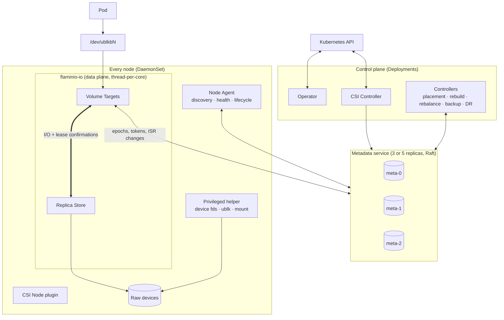
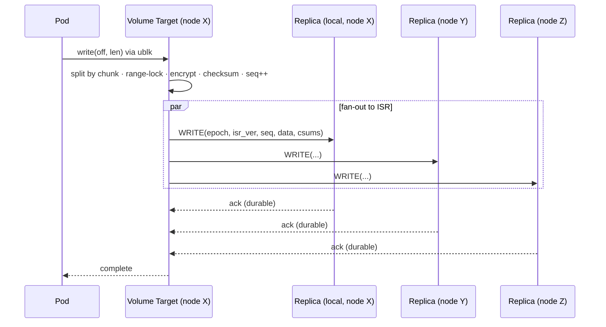
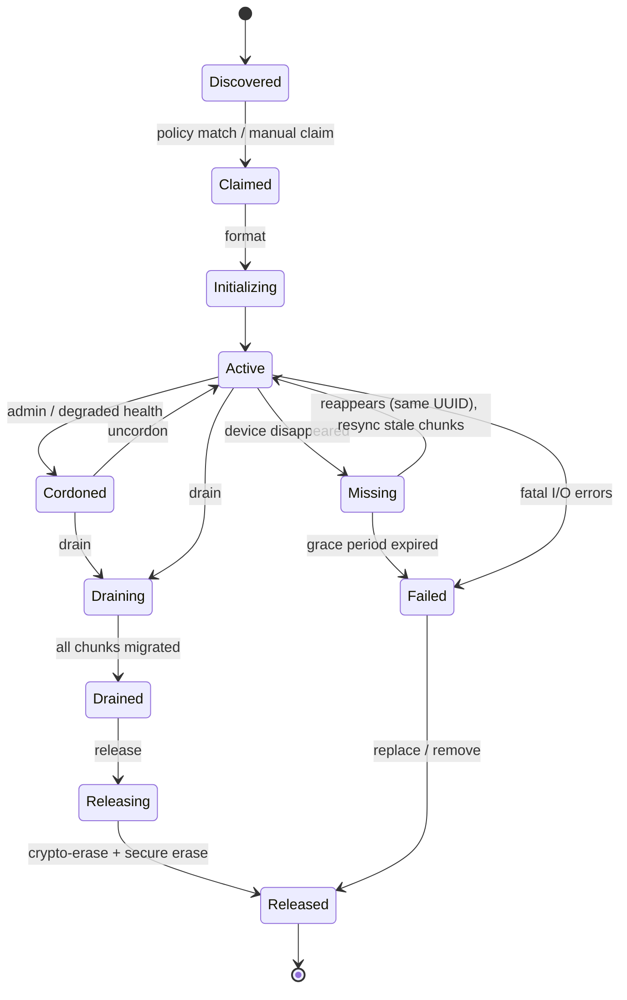

# Flaminio Architecture

> **Status:** Draft v0.2, for review. Agreed decisions are recorded as ADRs in
> [`docs/adr/`](adr/). Items marked **[OPEN]** are listed again in
> [§20 Open questions](#20-open-questions).
>
> **Decisions so far** (2026-10-08):
>
> | ADR | Decision | Status |
> |---|---|---|
> | [0001](adr/0001-languages.md) | Go for the Kubernetes-facing control plane, Rust for the data plane | Accepted |
> | [0002](adr/0002-metadata-backend-etcd.md) | Metadata service backed by a dedicated etcd cluster | Accepted |
> | [0003](adr/0003-kernel-baseline.md) | Linux 6.6 is the minimum kernel | Accepted |
> | [0004](adr/0004-target-environments.md) | Bare metal first, then small edge clusters, then cloud | Accepted |
> | [0005](adr/0005-replica-confirmed-leases.md) | I/O leases are confirmed by replicas, not by the metadata service | Accepted |
> | [0006](adr/0006-edge-two-node-degraded-writes.md) | 2-node edge sites keep accepting writes on a single copy while one node is down | Accepted |

## Contents

1. [Scope](#1-scope)
2. [Design principles](#2-design-principles)
3. [System overview](#3-system-overview)
4. [Core concepts](#4-core-concepts)
5. [Components](#5-components)
6. [On-disk format](#6-on-disk-format)
7. [I/O paths](#7-io-paths)
8. [Replication and consistency model](#8-replication-and-consistency-model)
9. [Placement and failure domains](#9-placement-and-failure-domains)
10. [Device and node lifecycle](#10-device-and-node-lifecycle)
11. [Failure handling and recovery](#11-failure-handling-and-recovery)
12. [Data integrity](#12-data-integrity)
13. [Snapshots and clones](#13-snapshots-and-clones)
14. [Backup and disaster recovery](#14-backup-and-disaster-recovery)
15. [Security architecture](#15-security-architecture)
16. [Performance design](#16-performance-design)
17. [Kubernetes integration and API](#17-kubernetes-integration-and-api)
18. [Upgrades and operations](#18-upgrades-and-operations)
19. [Testing strategy](#19-testing-strategy)
20. [Open questions](#20-open-questions)
21. [Glossary](#21-glossary)

---

## 1. Scope

Flaminio provides **replicated block volumes** (ReadWriteOnce, raw block or filesystem) to
Kubernetes workloads. The volumes are built from local devices (NVMe, SSD, HDD) attached to
cluster nodes.

**In scope (v1):** dynamic provisioning through CSI; configurable synchronous replication;
automatic device discovery, claiming, draining and replacement; failover; snapshots and clones;
encryption at rest; incremental backup to object storage; restore across clusters.

**Later:** asynchronous cross-cluster replication, erasure coding, RDMA, NVMe-oF export to
external hosts and VMs, RWX through an NFS gateway.

**Out of scope:** a distributed POSIX filesystem, object storage, non-Kubernetes deployments.

### 1.1 Target environments and phasing

All three environments are long-term goals. They are delivered in this order
([ADR 0004](adr/0004-target-environments.md)):

| Order | Environment | What changes for Flaminio |
|---|---|---|
| **1st** (phases 0–3) | **Bare metal** | The reference environment. Local NVMe/SSD/HDD, dedicated storage networks, RDMA-capable NICs later. All performance targets (§16.2) are measured here. |
| **2nd** (phase 4) | **Small edge clusters** (1–3 nodes) | Tight CPU and RAM budgets, no or intermittent WAN, physically exposed hardware, often arm64. See §1.2. |
| **3rd** (phase 5) | **Cloud** | Provider disks are already replicated, instance-store NVMe disappears when an instance stops, cross-zone traffic costs money, nodes come and go with autoscaling. |

Design rules that follow from this order:

- Nothing in phases 0–3 may assume a cluster of ≥ 3 nodes beyond what is written in the
  StorageClass. Edge support must not need a redesign later.
- The data plane has a **compact resource mode** from the start (§5.1), even though bare metal
  does not need it.
- Every external dependency (KMS, object store, DR peer) is assumed to be **sometimes
  unreachable**.

### 1.2 Edge profile (phase 4)

| Topology | Replication | Metadata service | Protection |
|---|---|---|---|
| 1 node | RF=1 | 1 member (no HA) | Scheduled backups and async replication to a central site |
| 2 nodes + witness | RF=2, `minInSyncReplicas: 1` by default ([ADR 0006](adr/0006-edge-two-node-degraded-writes.md)): writes continue on a single copy while one node is down | 3 members, one on a **witness**: a tiny voting member that stores no volume data. It can be a small arm64 board on site, or remote over the WAN | Same, plus survives the loss of either data node |
| 3 nodes | RF=2 or 3 | 3 members | Standard |

Edge-specific requirements:

- **Compact mode:** the whole control plane (controllers, CSI controller, operator) in one
  Deployment, and the data plane within about 1 core and 512 MiB RAM when idle.
- **Keys without a reachable KMS:** the KEK can be **sealed in the node's TPM** (bound to
  measured-boot PCRs), so encrypted volumes unlock at boot without reaching a remote KMS. A stolen
  disk on its own is useless.
- **WAN-tolerant data movement:** backups and async replication are resumable, bandwidth-capped,
  and can be limited to time windows.
- **Distribution coverage:** k3s, RKE2, Talos and MicroK8s on the 6.6+ kernel baseline. Whether
  each distribution ships `ublk_drv` must be verified.
- **Fleet operation:** many small clusters backing up to one central object store, with policies
  managed centrally (later).

## 2. Design principles

1. **The Kubernetes API server is never on the data path.** I/O, failover and rebuild keep
   working when the API server is slow or down. CRDs express *intent* and show *summarized
   status*. They are not the system of record for high-churn internal state.
2. **Safety without timing assumptions where possible.** Write safety (no split-brain, no lost
   acked writes) comes from epochs and linearizable metadata, not from timeouts. Timing (leases)
   is used only where it cannot be avoided, and every such place is documented (§8.5).
3. **The common case is fast and the rare case is correct.** The steady-state write path makes
   no metadata-service round trips. Failure handling may be slower, but it must be provably safe.
4. **Shared-nothing data plane.** Each core owns its queues, buffers and connections. There are
   no locks on the hot path.
5. **Secure by default.** mTLS, least-privilege tokens and encryption are on unless an operator
   explicitly turns them off. Turning them off is visible in status and in metrics.
6. **Every failure is a planned operation that happened suddenly.** Disk removal, node loss and
   upgrades use the same machinery (drain, rebuild, resync), so the rare paths get exercised
   all the time.
7. **Logic that can be simulated is logic that can be trusted.** Replication, membership and
   recovery logic are written as deterministic, sans-I/O state machines. That lets us test them
   under simulated faults (§19).

## 3. System overview



| Component | Runs as | Language | Responsibility |
|---|---|---|---|
| **flaminio-io** | DaemonSet container | Rust | Data plane: volume targets, replica store, replication protocol, frontends |
| **Node Agent** | DaemonSet container | Rust | Device discovery and health, lifecycle execution, node liveness heartbeat |
| **Privileged helper** | DaemonSet container | Rust | The only privileged process. Opens devices and passes fds, sets up ublk, mounts |
| **Metadata service** | StatefulSet | Go | System of record: topology, placement, epochs, ISR, node liveness, catalogs |
| **Controllers** | Deployment | Go | Placement, rebuild, rebalance, scrub scheduling, backup, DR, failover |
| **CSI driver** | Deployment + DaemonSet | Go | Kubernetes CSI controller and node services |
| **Operator** | Deployment | Go | Install, upgrade, CA bootstrap, CRD reconciliation |
| **kubectl-flaminio** | CLI plugin | Go | Admin UX: drain, release, status, doctor, recover |

## 4. Core concepts

| Concept | Definition |
|---|---|
| **Device** | A block device seen on a node (`/dev/nvme0n1`). It is identified by WWN/serial, never by path. |
| **Disk** | A device that Flaminio has claimed and formatted. It is identified by the UUID in its superblock. It belongs to one **device class** (e.g. `fast`, `capacity`). |
| **Failure domain** | A level in the topology tree: `disk < node < rack < zone < region`. It comes from node labels (`topology.kubernetes.io/zone`, plus custom labels). |
| **Volume** | A logical block device of size *S*, split into fixed-size **chunks**. |
| **Chunk** | A contiguous range of a volume (default **256 MiB**, set per StorageClass from 64 MiB to 1 GiB). Chunk is the unit of placement, replication, rebuild and migration. |
| **Chunk replica** | One copy of a chunk on one disk. Physical space is allocated lazily (thin provisioning). |
| **Replica set** | All replicas of a chunk. The **ISR** (in-sync replicas) is the subset known to have every acknowledged write. |
| **Volume target** | The per-volume I/O coordinator. It runs inside `flaminio-io` on the node that consumes the volume. |
| **Epoch** | A monotonically increasing number issued by the metadata service each time a volume gets a new target. Replicas reject any request that carries an older epoch. |
| **Layer** | A generation of a chunk replica's block map. Snapshots freeze a layer (redirect-on-write). |

Why chunks rather than whole-volume replicas:

- **Rebuild parallelism.** When a 4 TiB disk fails, its ~16 000 chunks are rebuilt from many
  source disks to many destination disks at once. Rebuild time shrinks as the cluster grows.
- **Smooth device add and remove.** Adding a disk means migrating some chunks onto it. Removing
  one means migrating its chunks off. Nobody has to move a whole multi-TiB replica.
- **Bounded resync.** ISR membership is tracked per chunk, so after a short outage only chunks
  that were *written during the outage* need a resync.
- **Volumes bigger than any one disk.**

Trade-off: there is more metadata than with per-volume replicas. At 256 MiB chunks, 1 PiB of
logical data is about 4 M chunks, or about 1–2 GB of metadata. That is manageable but drives the
choice of metadata backend (§5.4).

## 5. Components

### 5.1 flaminio-io (data plane)

A single process per node, written in Rust, with a **thread-per-core** architecture:

- **N reactor threads** (configurable, default 2 cores, scaling with load). Each one is pinned to
  a core and owns an `io_uring` instance, a registered buffer pool, network connections and a
  shard of volume targets and chunk replicas. Cross-core work goes through lock-free SPSC
  message queues.
- **Adaptive polling.** Threads busy-poll under load and park when idle, so there is no
  dedicated-core or hugepage requirement (unlike SPDK-based designs). An operator can pin
  dedicated cores for maximum performance.
- **Roles.** Every `flaminio-io` instance can host *targets* (for volumes used on this node),
  *replicas* (for chunks on this node's disks), or both. A compute-only node runs
  targets only.
- **Frontends.**
  - **ublk** (primary). A userspace block device driven by `io_uring`, which avoids the
    iSCSI/NBD protocol overhead. `UBLK_F_USER_RECOVERY` lets `flaminio-io` crash or upgrade
    while `/dev/ublkbN` stays alive and pending I/O is requeued. The pod sees a pause, not an
    error.
  - **NVMe/TCP loopback** (fallback, for kernels without usable ublk). The kernel NVMe host
    connects to a userspace NVMe/TCP target in `flaminio-io`. It also gives native NVMe
    multipath.
  - **NVMe-oF export** (phase 6) for VMs and external hosts.
  - **vhost-user-blk** (phase 6) for KubeVirt.
- **Compact mode.** A single reactor thread, a small buffer pool and lazy map caching, for edge
  nodes (§1.2).
- **Privilege separation.** `flaminio-io` runs **unprivileged**. The privileged helper opens raw
  devices and the ublk control device, then passes file descriptors over a Unix socket
  (`SCM_RIGHTS`), the same pattern OpenSSH uses for privsep. A memory-safety bug in the data
  plane does not hand an attacker root on the node.

### 5.2 Node Agent

- **Discovery.** It watches udev, enumerates devices, and reads WWN, serial, model, size,
  rotational flag, NVMe namespace info, PI/metadata support and existing signatures (partitions,
  filesystems, LVM, other storage systems). It publishes `Device` records.
- **Claim policy.** It matches devices against `DevicePolicy` selectors. **By default it never
  claims a device that has any signature**, and an operator must explicitly override this per
  device.
- **Health.** SMART/NVMe log pages (media errors, spare, wear, temperature, critical warnings),
  I/O error counters from `flaminio-io`, and per-disk latency distributions. It feeds gray-failure
  detection (§11.3).
- **Node liveness.** It renews the node's liveness record in the metadata service every 2–3 s.
  That record is used **only to decide when to fail over** (§11.2). It does not grant I/O
  permission (§8.5).
- **Lifecycle execution.** Format, drain progress reporting, crypto-erase and secure erase.

### 5.3 Volume target

The target is the brain of a volume's I/O. It runs on the consumer node and handles:

- Splitting I/O at chunk boundaries, and serializing overlapping in-flight writes with a range
  lock.
- Encryption and decryption (§15.4), and checksum computation.
- Fan-out of writes to the ISR (plus rebuilding replicas), and choosing a replica for each read.
- Detecting replica failures and committing ISR changes to the metadata service.
- Per-volume QoS limits.

The target caches the volume's placement map and ISR set. It is told about changes through a
watch stream from the metadata service. A version number on each request detects a stale cache.

### 5.4 Metadata service

It is the system of record for: nodes and their liveness, disks, device classes, volumes, chunk
placement, ISR sets with versions, epochs, capability-token signing keys, the snapshot and backup
catalogs, and the audit log.

It is built as a domain service (placement, ISR transitions, epoch issuance, token signing) on
top of a **dedicated etcd cluster** (not the Kubernetes one), behind a narrow storage interface
([ADR 0002](adr/0002-metadata-backend-etcd.md)). Clients only ever talk to the domain service,
never to etcd directly. Custom Raft (multi-Raft sharding) stays possible later if a cluster
outgrows etcd's practical ~8 GB limit. At 256 MiB chunks that limit is several PiB of logical
data.

**Replication of the metadata service.** etcd is itself Raft-replicated:

- **Members:** 3 by default, or 5 when there are ≥ 3 zones or racks (spread 2-2-1, which
  survives losing any one zone). Members are spread across failure domains on nodes labelled
  `flaminio.io/meta`, with the Raft log on a dedicated small partition.
- **Automatic member replacement:** if a member stays down past a timeout (default 15 min), the
  operator adds a replacement on a healthy eligible node and then removes the dead one. It does
  this one member at a time and never drops below quorum, so a series of single failures cannot
  slowly turn into a quorum loss.
- **Witness members** for 2-node edge sites (§1.2).
- **Encrypted snapshots** of the metadata, written to the backup target (§11.5).

Replication makes losing a majority rare. It cannot make a node that is *cut off* from the
majority safe to act on its own, because a cut-off node cannot tell "the metadata service is
down" from "I am partitioned and somebody else has taken over". That is why the metadata
service is kept out of the I/O permission path entirely (§8.5).

The metadata service is involved in I/O **only** for ISR changes when a replica fails, and for
attach/failover (epoch issuance). It is not involved in normal reads, writes or lease renewal.

### 5.5 Controllers

These are stateless reconcilers with leader election. They act on metadata-service state, and
they also mirror summaries into CRDs.

- **Placement.** Picks disks for new chunks and replacement replicas (§9).
- **Rebuild / resync.** Restores redundancy and prioritizes chunks with the least redundancy left.
- **Rebalance.** Evens out disk utilization after topology changes, with throttling.
- **Lifecycle.** Drives the disk and node state machines (§10).
- **Failover.** Handles node liveness expiry, epoch bumps and safe pod eviction (§11.2).
- **Scrub scheduler**, **Backup / DR**, **Capacity** (watermarks, overcommit alerts).

## 6. On-disk format

Flaminio owns the whole raw device. There is no host filesystem underneath, which removes a
layer of caching, journaling and metadata overhead.

The byte-level specification is [`docs/format/on-disk-format-v1.md`](format/on-disk-format-v1.md),
and its reference implementation is the `flaminio-format` crate.

```
 ┌──────────────┬───────────────────┬──────────────────────┬─────────────────────────────┬──────────────┐
 │ Superblock A │ Journal (WAL)     │ Metadata area        │ Data area                   │ Superblock B │
 │ 4 KiB        │ circular, ~1 GiB  │ chunk table, maps,   │ 64 KiB clusters             │ 4 KiB        │
 │              │ group-committed   │ checksums, alloc map │                             │              │
 └──────────────┴───────────────────┴──────────────────────┴─────────────────────────────┴──────────────┘
```

- **Superblock** (two copies). It holds magic, format version, feature flags
  (compat/ro-compat/incompat), the disk and cluster UUIDs, cluster size, region offsets and a
  checksum.
- **Journal.** A circular write-ahead log of checksummed records with group commit. Record
  types: `DeferredWrite`, `MapUpdate`, `Alloc`/`Free`, `ChunkCreate`/`ChunkDelete`, `Fence`,
  `LayerCreate`. The journal can optionally sit on a separate faster device (e.g. an NVMe journal
  for HDD capacity disks).
- **Metadata area.** For each chunk replica there is a header (volume UUID, chunk index, epoch,
  last sequence number, layers) and one block map per layer (cluster → physical cluster, plus
  4 KiB checksums). Metadata is checkpointed periodically, and the journal is replayed on start.
  Hot maps are cached in RAM with an LRU and a configurable memory budget.
- **Data area.** Allocated in **64 KiB clusters** (set at format time, 16–256 KiB).

**Write atomicity**, modelled on BlueStore's split between small and large writes:

- **Large writes** (≥ cluster size and aligned) are **redirect-on-write**: data goes to a newly
  allocated cluster, and a `MapUpdate` (new location, checksums, sequence number) is committed
  to the journal. The switch is atomic, and the old cluster is freed unless a snapshot still
  references it.
- **Small writes** are **deferred**: data, checksums and sequence number go into a single
  `DeferredWrite` journal record and are applied in place in the background. The latency cost is
  one sequential, group-committed journal write.

So **every write is all-or-nothing on a replica**, and checksums never disagree with data
because of a torn write. A group of writes needs **one flush**. Data and journal batch go to the device together, and
recovery checks the last batch's data against the checksums its records carry (format spec
§6.2). Each replica acknowledges a write only once it is durable. A volatile
device cache is flushed with FUA or a flush command; disks with power-loss protection skip the
flush.

**Self-description.** Every disk holds enough to rebuild the metadata service from scratch: the
per-chunk headers, plus a small replicated *volume descriptor* (size, chunk size, replication
factor, wrapped DEK reference) for every volume that has chunks on the disk (§11.5).

## 7. I/O paths

### 7.1 Write



1. The target splits the request at chunk boundaries, takes a range lock (overlapping writes are
   serialized so replicas apply them in the same order), encrypts the data if enabled, computes
   per-4 KiB checksums, and assigns a per-chunk sequence number.
2. It sends `WRITE` to **every ISR member in parallel** (star fan-out) and also to any
   *rebuilding* replicas of the chunk.
3. Each replica checks `epoch ≥ fenced_epoch` and `isr_ver`, then writes durably (§6) and acks.
4. The target completes the I/O when **all ISR members** have acked. Acks from rebuilding
   replicas are not waited for.
5. If an ISR member fails or times out, the target follows §8.3 **before** completing the write.

With data locality enabled, one replica is on the consumer's node, so write latency is about
`max(local write, network RTT + remote write)`.

### 7.2 Read

- It reads from **any ISR replica**: the local one if it is in sync, otherwise the replica with
  the fewest outstanding I/Os and lowest recent latency.
- It verifies the checksum. On a mismatch it reads another ISR replica, returns the good data,
  and asynchronously **repairs** the bad copy (§12).
- Because writes are acked only after every ISR member is durable, a read issued after a write
  completes sees that write on any ISR replica.

### 7.3 Flush and FUA

Replicas acknowledge only durable writes, so `FLUSH` is effectively a barrier through the target
and costs almost nothing. An optional **write-back mode** (acknowledge before durable, honor
`FLUSH`) can be enabled per StorageClass for scratch workloads. It is **off by default**.

### 7.4 Discard / TRIM

Discards turn into map updates that free clusters (unless a snapshot references them).
Discarding a whole chunk frees the chunk replica on every disk.

## 8. Replication and consistency model

### 8.1 Guarantees

- **Linearizable single-volume block semantics** for one attached target (RWO). A write that has
  been acknowledged is never lost while at least one ISR member survives, and every later read
  returns it.
- **Durability:** an acknowledged write exists on `|ISR|` replicas, and `|ISR| ≥ minInSyncReplicas`
  always holds.
- **No split-brain:** at most one target can complete writes for a volume at any time (§8.4).

### 8.2 Configuration (per StorageClass)

| Parameter | Default | Meaning |
|---|---|---|
| `replicas` | 3 | Target replication factor (1–5) |
| `minInSyncReplicas` | 2 | Writes **block** rather than proceed with fewer in-sync copies |
| `failureDomain` | `node` | The level that replicas of one chunk must be spread across |
| `failureDomainPolicy` | `strict` | `strict` refuses placement if the topology is short. `bestEffort` falls back to the next level down |
| `dataLocality` | `preferred` | `disabled` / `preferred` / `required`: keep one replica on the consumer's node |
| `chunkSize` | 256Mi | Unit of placement and rebuild |

### 8.3 ISR management

The ISR is tracked **per chunk** and versioned (`isr_ver`).

- **Shrink.** If a replica fails or times out on a write, the target proposes
  `ISR(chunk) := ISR − {r}` to the metadata service **with its epoch**. The write completes only
  after that change is committed. Without this, a later failover could choose the stale replica
  as the source of truth. If the shrink would take the ISR below `minInSyncReplicas`, the write
  blocks and retries for `writeBlockTimeout`, then fails with EIO. Many chunks hitting the same
  failed replica are **batched** into one metadata transaction.
- **Dirty tracking.** When an ISR member sees a write with a newer `isr_ver` that excludes a
  peer, it starts a per-chunk bitmap (4 KiB granularity, 8 KiB per chunk) of blocks written
  since then. The bitmap is persisted lazily. If it is lost, resync falls back to copying the
  whole chunk.
- **Expand.** A returning or new replica is brought up to date (§11.4) and then added to the ISR
  through a metadata commit.

### 8.4 Epochs and fencing (split-brain prevention)

- Each attach or failover makes the metadata service increment the volume **epoch** and issue a
  **capability token** `{volume, epoch, node, rights}` signed with the service's key.
- Before its first I/O, a new target sends `FENCE(epoch)` to every replica of the volume. Each
  replica persists `fenced_epoch` and from then on rejects any request with a lower epoch, reads
  included. Replicas the target cannot reach are removed from the ISR in the metadata service
  under the new epoch.
- ISR changes are conditional on the current epoch, so **an old target can neither collect acks
  from fenced replicas nor shrink the ISR around them.** It cannot complete a write. This holds
  regardless of clocks, pauses or partitions.

### 8.5 Leases: who may serve I/O

*Decided in [ADR 0005](adr/0005-replica-confirmed-leases.md).*

Epochs (§8.4) stop an old target from completing writes. They do not stop it from *reading* a
replica that the new target could not reach, and so could not fence. Leases close that gap.
**The leases are confirmed by the replicas, not granted by the metadata service**, so the
metadata service stays off the I/O path.

- **Replica-confirmed lease.** A target may serve I/O for a chunk only while **every ISR member**
  of that chunk has confirmed its epoch within the last `L` (default 5 s). Confirmations ride
  on I/O replies and on one heartbeat per *pair of nodes* that covers all volumes between them.
  The cost does not grow with the number of volumes.
- **Why it is safe.** A fenced replica refuses to confirm an older epoch. A new target must fence
  at least one ISR member of every chunk anyway, because it needs an up-to-date source. From that
  moment the old target cannot renew, because it needs *all* ISR members, and its lease expires
  within `L`.
- **When the new target may serve.** It serves a chunk once every ISR member is fenced and the
  in-flight writes are reconciled. If some ISR members cannot be reached, it first waits
  `L × (1 + ρ)` after fencing the first one, then removes the unreachable ones from the ISR.
  Serving earlier would let the old target, reading an unfenced member, and the new target
  disagree about an unfinished write. An old target never reads from a member whose ISR
  removal is in flight. The exact rules, checked by simulation, are in
  [replication-protocol.md](replication-protocol.md).
- **Timing assumption:** only a bounded clock *rate* drift ρ. Both sides measure durations on
  their own monotonic clocks, so no clock synchronization is required.
- The same rule protects writes (all ISR members must ack) and leases (all ISR members must
  confirm). There is one invariant to reason about, not two.
- **Node liveness** records in the metadata service still exist, but only to decide *when* to
  fail over (§11.2), never to permit I/O.

What this changes compared with leases granted by the metadata service:

| Situation | Leases granted by metadata service | Replica-confirmed leases |
|---|---|---|
| Total metadata outage | All I/O suspends once leases expire | **I/O continues.** Provisioning, attach/failover and ISR changes wait for the metadata service |
| Metadata outage **and** a replica fails | All I/O suspended | Only the chunks that lost a replica block, because their ISR cannot shrink. Everything else continues |
| Node cut off from the metadata service only | Its I/O suspends | **I/O continues** |
| Node cut off from its replicas | Its I/O suspends | Its I/O suspends (the lease cannot be confirmed). ublk queues the I/O, so applications see latency, not errors |
| Remote witness over a slow WAN (edge) | Lease renewals cross the WAN | Unaffected. The witness is never on the I/O path |

**Failover timing.** A volume moves away from a node only after the node's liveness record has
expired plus a margin, **or** after explicit fencing confirmation: the
`node.kubernetes.io/out-of-service` taint, the Node object being deleted, or the cloud provider
reporting the instance stopped.

## 9. Placement and failure domains

The placement controller solves a constrained choice for every chunk replica:

**Hard constraints:** the device class matches; replicas of a chunk are in distinct failure
domains at the configured level; the disk is `Active` (not cordoned, draining or degraded); and
the disk is below its high watermark.

**Scoring (weighted):** low utilization; spread of a volume's chunks across many disks (rebuild
parallelism); data locality (one replica on the consumer's node); low recent latency; and
avoiding disks that share failure history (same model or batch, as an optional hint).

Other placement rules:

- Placement for all chunks is decided **at volume creation** (metadata only). Physical space is
  allocated on first write, so the hot path never waits for placement.
- **Locality migration.** With `dataLocality: preferred`, when a volume attaches on a node with
  no local replicas, a background task migrates one replica of each chunk to that node (only if
  the node has a suitable disk).
- **Rebuild reserve.** Capacity accounting keeps enough free space to re-protect the data of the
  largest failure-domain unit (by default, the largest node). This ensures a single failure can
  always be healed.

## 10. Device and node lifecycle

### 10.1 Disk state machine



### 10.2 Adding capacity

1. A new device appears. The Node Agent publishes `Device`, and a matching `DevicePolicy` claims
   and formats it (or the admin runs `kubectl flaminio disk claim`).
2. The disk becomes `Active` and immediately eligible for new chunks.
3. The rebalancer migrates chunks onto it until utilization variance is within a tolerance.
   Migration is throttled and runs at background I/O priority.

Adding a node is the same flow: the DaemonSet lands, the agent discovers disks, and the policy
claims them.

### 10.3 Planned removal

`kubectl flaminio disk drain <node>/<disk>` (or `node drain`):

1. `Cordoned`: no new chunks are placed on it.
2. `Draining`: each chunk replica gets a new replica elsewhere (copy plus live write mirroring,
   §11.4). Once the new replica joins the ISR, the old one is removed. **Redundancy never drops
   during a drain.**
3. `Drained`, then `release`: the per-disk keys are destroyed (crypto-erase), NVMe
   Sanitize/Format runs with secure erase when supported, the signature is wiped, and the device
   is handed back.

### 10.4 Kubernetes node maintenance

- **Storage disruption guard.** A controller keeps a PodDisruptionBudget per storage node (the
  pattern Rook uses). It blocks `kubectl drain` when taking the node down would push any chunk
  below `minInSyncReplicas`.
- **Maintenance mode.** `kubectl flaminio node maintenance <node> --window 30m` marks the node's
  replicas *expected-unavailable*. No rebuild starts during the window, and on return only the
  dirty regions are resynced. This avoids a rebuild storm during rolling OS upgrades.

### 10.5 Surprise removal / failure

A surprise failure is handled as a drain with the source gone: `Missing` → (after
`replicaReplenishmentWait`, default 10 min) `Failed` → rebuild the lost replicas from the
survivors. If the disk returns before the timeout with the same superblock UUID, only the stale
chunks are resynced.

## 11. Failure handling and recovery

### 11.1 Failure matrix

| Scenario | Detection | Immediate effect | Recovery |
|---|---|---|---|
| Transient replica stall / network blip | Target I/O timeout (adaptive, default 3 s) | ISR shrinks (if still ≥ min). Writes continue | Dirty-region resync on return |
| `flaminio-io` crash on a **storage** node | Connection reset | Same as above | Restart in seconds. Resync only the chunks written meanwhile |
| `flaminio-io` crash/upgrade on the **consumer** node | ublk daemon loss | I/O paused (not failed) | New process reattaches via ublk user recovery, bumps the epoch, reconciles in-flight writes (§11.4) |
| Disk failure | I/O errors, device removal, SMART critical | Disk `Failed`. Chunks degraded | Many-to-many rebuild, lowest redundancy first |
| Storage node failure | Node liveness expiry | Chunks degraded. Volumes keep serving if ≥ min ISR | Wait `replicaReplenishmentWait`, then rebuild. Resync if the node returns first |
| Consumer node failure | Node liveness expiry | Volume's target lost | Epoch bump, fenced pod eviction, reschedule, new target fences and reconciles (§11.2) |
| Network partition | Lease confirmation failure (§8.5) | Targets cut off from their ISR replicas suspend I/O | The side with the metadata quorum fails over. Safety comes from epochs + replica-confirmed leases (§8.4, §8.5) |
| Slow disk / gray failure | Latency outlier vs. peers (§11.3) | Removed from read selection, then ISR | Disk `Degraded`, optional auto-drain |
| Silent corruption | Checksum mismatch on read or scrub | Good copy served | Bad copy repaired from an ISR peer (§12) |
| Metadata member loss | Raft | None (quorum held) | Operator automatically replaces the member (§5.4) |
| Metadata quorum loss | Raft | **I/O continues.** No provisioning, attach, failover or ISR changes. Chunks that lose a replica meanwhile block | Restore quorum, or rebuild from disks + metadata backup (§11.5) |
| Zone outage | Liveness expiry of many nodes | Survives if RF and topology allow (e.g. RF=3 across 3 zones, min=2) | Rebuild when capacity allows, or wait for the zone |
| Whole-cluster power loss | — | All down | Journal replay, in-flight write reconciliation, ISR intact |
| Cluster destroyed | — | — | Restore from backup, or promote the async DR replica (§14) |
| Capacity exhaustion | Watermarks | Soft: no new placement. Hard: writes that need allocation get ENOSPC | Alerts, overcommit limits, add capacity (§11.6) |
| All ISR replicas lost | ISR = ∅ | Volume unavailable | Admin may **force-promote** the freshest out-of-ISR replica after explicitly acknowledging data loss |

### 11.2 Fast, safe pod failover

Kubernetes by default waits about 5 minutes before evicting pods from a `NotReady` node, and a
StatefulSet will not recreate a pod until the old one is gone. Because Flaminio fences the old
writer itself, it can safely speed this up:

1. The node's liveness record expires and the safety margin passes (or out-of-service is
   confirmed).
2. The failover controller bumps the epoch of every RWO volume attached to that node.
3. It force-deletes the affected pods (policy `nodeDownPodDeletion: fenced`, opt-in per
   StorageClass) and removes the stale VolumeAttachment.
4. The pod is rescheduled. A new target attaches, fences the replicas, reconciles in-flight
   writes and serves I/O.

### 11.3 Gray-failure detection

- Each target keeps per-replica latency histograms. Each disk's latency is compared against
  peers of the same device class.
- A replica whose p99 exceeds `k × class median` over a sliding window (with hysteresis) is first
  **dropped from read selection**. If write latency stays bad, it is **removed from the ISR**
  (only if the ISR stays ≥ min), and its disk is marked `Degraded`.
- Repeated degradation on one disk triggers an auto-drain if the policy allows it.

### 11.4 Rebuild, resync and in-flight reconciliation

- **Rebuild (new replica).** The new replica is added as `Rebuilding` and immediately receives
  live writes. A copier on the destination node pulls *allocated* clusters from an ISR source,
  but never overwrites blocks that a live write has already set (tracked with a 4 KiB bitmap). It
  then flushes, and the replica joins the ISR. Sources and destinations are spread so that
  thousands of chunks rebuild in parallel. Rebuild bandwidth is adaptive: aggressive when
  redundancy is low, gentle when only one replica is missing.
- **Resync (returning replica).** It copies only the blocks in the dirty bitmaps kept by ISR
  peers since its removal (§8.3), and only for chunks whose ISR it was actually removed from.
- **In-flight reconciliation after a target crash.** Writes that were in flight but not acked
  may have landed on some replicas and not others. The new target asks each ISR replica for the
  per-chunk sequence numbers in its recent journal window. Where replicas differ, the
  missing writes are copied from the most advanced replica (rolled forward). Overlapping writes
  were serialized by the range lock, so the union is well defined. Block semantics allow either
  value for an unacknowledged write; the only requirement is that replicas **converge**.

### 11.5 Metadata disaster recovery

- The metadata service writes **periodic snapshots** (encrypted) to the backup target.
- `kubectl flaminio recover meta` rebuilds a metadata store from the **self-describing disks**
  (§6). It scans every disk's chunk headers and volume descriptors, chooses the highest epoch and
  sequence number per chunk, and reconciles against the last metadata snapshot when there is
  one. It is a last resort, but it means losing the metadata store never means losing the data.

### 11.6 Capacity safety

Thin provisioning with an **overcommit ratio** per device class (default 1.0, so no overcommit),
and watermarks (default 80% soft, 90% high, 95% hard). Rebuild and drain may use space up to the
hard watermark. New volumes may not. Alerts fire well before any write can see ENOSPC.

## 12. Data integrity

- **Checksums:** crc32c (hardware accelerated) per 4 KiB block, computed **by the target** on the
  bytes as stored (ciphertext if encrypted) and verified by the replica on write and by the
  target on read. The data is protected end to end, across the network and the disk.
- **Authenticated mode** (for encrypted volumes, **[OPEN]** whether to make it the default): a
  keyed MAC (truncated BLAKE3-keyed, 16 B) replaces the crc, so a compromised replica node cannot
  forge data and checksum together. Known limitation: a node could replay an older version of
  the same block. Sequence numbers make this detectable during scrub, but not on every read.
- **NVMe PI / metadata** is used when the device supports it, so the device itself also verifies.
- **Scrubbing:** a background full pass over every disk (default every 14 days, throttled). It
  verifies checksums and compares per-chunk digests across replicas. Mismatches are repaired from
  the ISR majority and good checksum. Media-error counts feed disk health.

## 13. Snapshots and clones

- **O(1) snapshots.** A snapshot bumps the volume's *snapshot generation* in the metadata service
  and in the target. No fan-out is needed. Writes carry the generation, and a replica that
  receives a write with a newer generation first creates a new layer (redirect-on-write) for
  that chunk. Chunks that are never written again cost nothing.
- **Crash-consistent** by default (the target briefly drains in-flight I/O at the generation
  bump). **Application-consistent** through `fsfreeze` on filesystem volumes, or pre/post exec
  hooks declared by annotation.
- **Group snapshots** (Kubernetes `VolumeGroupSnapshot`): every target in the group drains and
  bumps its generation inside one coordinated barrier, giving crash consistency across all of an
  application's PVCs.
- **Clones.** A linked clone references the parent snapshot's layers on the same disks. That is
  instant, with an optional background *hydration* that fully detaches it. A full clone is a
  rebuild-style copy to new placement.
- **Snapshot cost.** After a snapshot, the first small write to a cluster pays a 64 KiB
  copy-on-write. This should be documented, and tunable through the cluster size.

## 14. Backup and disaster recovery

### 14.1 Backups to object storage (S3-compatible)

- **Incremental by construction.** A backup reads only clusters that changed between the
  previous backed-up snapshot and this one, using layer diffs. A full scan is never needed.
- **Format.** Data is cut into fixed 4 MiB blocks, addressed by **keyed** BLAKE3 hash (so the
  storage provider cannot confirm content), compressed with zstd, and encrypted with
  XChaCha20-Poly1305 under the backup-repository key. An encrypted manifest per backup lists the
  block addresses. Blocks are deduplicated within each repository.
- **Encrypted volumes are backed up as ciphertext** (with a reference to their wrapped DEK), so
  backup workers never see plaintext. Restoring needs access to the same KMS key, or to an
  exported key escrow.
- **Ransomware resistance.** S3 Object Lock (compliance mode) with retention. The uploader's
  credentials are write-only (no delete), and retention and garbage collection run under a
  separate identity.
- **Schedules and retention** through `BackupPolicy` (e.g. hourly × 24, daily × 14,
  monthly × 12).
- **Restore** to the same or another cluster. *Instant restore* (phase 6) makes the volume usable
  immediately and fetches blocks on demand, with background hydration.
- **Kubernetes objects** (PVC/PV manifests, application state) are left to Velero. Flaminio
  works with the CSI snapshot data-mover path.

### 14.2 Asynchronous cross-cluster replication (phase 4)

- **Snapshot shipping.** The primary takes periodic snapshots (RPO = interval, down to about
  1 min) and ships layer diffs over mTLS to the DR cluster's Flaminio, or through a shared
  bucket. Trust between clusters comes from an explicit CA-bundle exchange.
- **Standby volumes** are read-only and cannot be attached until promoted.
- **Promote** breaks the relationship. **Failback** reverse-replicates from the last common
  snapshot, so no full resync is needed.
- **Consistency groups** replicate several volumes at the same point in time.
- **Later:** continuous journal-based replication for an RPO of seconds.

### 14.3 DR runbooks (shipped with the product)

The product ships runbooks for: losing one zone; losing the metadata quorum; losing the whole
cluster (restore from backup); ransomware (restore from immutable backups to a clean cluster);
and a failed upgrade (rollback).

## 15. Security architecture

### 15.1 Threat model

| Adversary | Goal | Primary controls |
|---|---|---|
| Malicious or compromised **tenant pod** | Read or alter other tenants' volumes | No data-plane network reachability from pods (NetworkPolicy and a dedicated port on host networking), CSI path validation, nosuid/nodev mounts |
| **Network attacker** on the cluster or storage network | Sniff or tamper with data and control traffic | mTLS everywhere, with kTLS on the data path |
| **Compromised node** | Read or alter volumes it does not host targets for | Capability tokens scoped by volume, epoch and node. Encryption at the target, so replica nodes see only ciphertext. Authenticated mode |
| **Stolen, RMA'd or decommissioned disk** | Recover data | Encryption at rest, crypto-erase on release, secure erase |
| **Compromised backup bucket** | Read, alter or delete backups | Client-side encryption, keyed addressing, Object Lock, write-only uploader credentials |
| **Over-privileged Kubernetes user** | Destroy data | Split RBAC (admin CRDs vs tenant), admission policy, audit log, deletion protection |
| **Supply-chain attacker** | Ship a malicious build | Signed, reproducible builds, SBOM, provenance, dependency policy |

### 15.2 Identity and transport

- **Workload identity.** Each component gets a short-lived X.509 certificate (24 h, auto-rotated)
  with a SPIFFE-style ID (`spiffe://<cluster>/flaminio/node/<node>/io`). Certificates are issued
  by an internal CA held by the operator; cert-manager or SPIRE can be plugged in instead. A node
  bootstraps by presenting a projected, audience-bound ServiceAccount token, which the CA
  validates through TokenReview (the same model as kubelet TLS bootstrap).
- **mTLS on every link:** control gRPC, metadata Raft, and replication. The data path uses
  **kTLS** (kernel TLS 1.3, offloadable to NICs) to keep the CPU cost low.
- **Capability tokens.** A replica accepts I/O for a chunk only from a session whose token (signed
  by the metadata service) names that volume and an epoch ≥ `fenced_epoch`. A valid node
  certificate alone grants nothing.

### 15.3 Authorization and multi-tenancy

- **RBAC split.** Admin resources (`DevicePolicy`, `Disk`, `StorageNode`, `KMSProvider`,
  `BackupTarget`) are cluster-scoped and admin-only. Tenants use only standard PVC and
  VolumeSnapshot objects.
- **Admission policy** (ValidatingAdmissionPolicy and a webhook) can, for example, restrict which
  namespaces may use unencrypted or RF=1 classes, enforce quotas per device class, and require
  deletion protection.
- An **append-only audit log** in the metadata service records every destructive or key
  operation, with identity, and can be exported to a SIEM.

### 15.4 Encryption at rest

- **AES-256-XTS** with a per-volume data encryption key (DEK). The tweak is the volume-logical
  block number, so every replica stores identical ciphertext. That is required for scrub
  comparison and resync.
- **Encryption happens in the target**, on the node running the workload. Replica and backup
  nodes only see ciphertext.
- The DEK is **wrapped** by a KEK in an external KMS: HashiCorp Vault Transit, AWS KMS, GCP KMS,
  Azure Key Vault, or KMIP. Vault and KMIP come first; cloud KMS providers come with the cloud profile
  (phase 5). A Kubernetes Secret KEK is allowed but flagged as weaker.
- The unwrapped DEK exists only in target memory. That memory is `mlock`ed, zeroized on drop,
  excluded from core dumps (`MADV_DONTDUMP`), and never logged.
- **Rekey of the KEK** is cheap: re-wrap the DEK. A **DEK rotation** requires rewriting the data
  and runs as a background migration.
- **Crypto-erase:** destroying the DEK makes every replica and backup of the volume unreadable.
- OPAL self-encrypting drives are supported as an extra layer (phase 6).
- **TPM-sealed KEK** for edge nodes that cannot reach a KMS at boot (phase 4, §1.2).

### 15.5 Runtime hardening

- **Memory-safe data plane** (Rust). `unsafe` is confined to the io_uring, ublk and crypto FFI
  modules, which get extra review and fuzzing.
- **Privilege separation** (§5.1). Only the small helper is privileged. Controllers run as
  non-root with a read-only root filesystem and distroless images.
- **Seccomp, AppArmor and SELinux profiles** ship for every container. The data-plane profile
  allows `io_uring` (most default container seccomp profiles block it).
- Data-plane listeners bind only to the storage network interface. NetworkPolicies ship with the
  chart.

### 15.6 Supply chain

Reproducible builds; cosign-signed images and charts; SPDX SBOMs; SLSA L3 provenance;
`cargo-deny`, `cargo-audit` and `govulncheck` in CI; continuous fuzzing of protocol and on-disk
parsers (cargo-fuzz, aiming for OSS-Fuzz); and a published security policy and disclosure
process.

## 16. Performance design

### 16.1 Techniques

| Area | Technique |
|---|---|
| Kernel boundary | ublk + `io_uring`, batched submissions, registered buffers and files, optional SQPOLL |
| Copies | ublk zero-copy where the kernel supports it; `io_uring` zero-copy send; receive into registered buffers |
| Concurrency | Thread-per-core, shared-nothing, no locks on the hot path, per-core connections between node pairs |
| Disk I/O | `O_DIRECT` to raw devices, no host filesystem, group-committed journal, large writes are redirect-on-write |
| Network | Dedicated storage network supported (Multus or host interface selection), kTLS offload, RDMA in phase 6 |
| Reads | Local short-circuit when in sync, least-loaded replica selection |
| Background work | Weighted fair queuing per core between classes (foreground, rebuild, scrub, backup), adaptive rebuild rate |
| QoS | Per-volume IOPS and bandwidth limits and burst, set through StorageClass or PVC annotation |

### 16.2 Targets (to be validated in phase 0–1)

| Metric | Target |
|---|---|
| 4 KiB random read, local replica, QD32 | ≥ 90% of raw-device IOPS |
| 4 KiB random write, RF=3, QD1, p50 latency | ≤ network RTT + device write latency + 30 µs |
| Sequential throughput, single volume | Line rate of the storage network (≥ 25 GbE) |
| Data-plane CPU | Tracked as CPU-µs per I/O. Regressions gate CI |
| Rebuild of a failed 4 TiB disk, 10 nodes, 25 GbE | < 30 min to full redundancy |
| Consumer-side data-plane restart (upgrade) | I/O pause < 2 s |

### 16.3 Benchmarking

There is a reproducible harness in `test/perf/` with fio profiles (random/sequential × read/write
× QD1/QD32 × 4K/64K/1M) plus database workloads (pgbench, sysbench). It covers replica counts and
encryption on and off, and runs head-to-head against Longhorn (v1 and v2 engines),
OpenEBS Mayastor, Rook-Ceph RBD and raw devices. Results are published with full hardware and
configuration details.

## 17. Kubernetes integration and API

### 17.1 CSI

| Feature | Phase |
|---|---|
| Dynamic provisioning, delete, `WaitForFirstConsumer` topology | 1 |
| Raw block and filesystem (ext4, xfs) volume modes | 1 |
| ReadWriteOnce, ReadWriteOncePod | 1 |
| Online expansion | 1 (where the kernel supports ublk resize; offline otherwise) |
| VolumeSnapshot, clone from snapshot or PVC | 3 |
| VolumeGroupSnapshot | 3 |
| Volume health monitoring (`VolumeCondition`) | 2 |
| ReadWriteMany (NFS gateway) | 6 |

### 17.2 CRDs (`storage.flaminio.io/v1alpha1`)

| Kind | Scope | Purpose |
|---|---|---|
| `FlaminioCluster` | Cluster | Installation config: networks, CA, metadata members, defaults |
| `DevicePolicy` | Cluster | Which devices to claim automatically, and as which device class |
| `Device` | Cluster | Discovered devices (read-only inventory) |
| `Disk` | Cluster | Claimed disks: desired state (active, cordoned, draining, released) and summarized status |
| `StorageNode` | Cluster | Per-node status, maintenance windows |
| `Volume` | Cluster | Summarized volume status: health, ISR summary, rebuild progress (low-frequency mirror) |
| `KMSProvider` | Cluster | KMS connection and KEK reference |
| `BackupTarget` / `BackupPolicy` | Cluster | Object-store target, schedules and retention |
| `ReplicationRelationship` | Cluster | Async DR pairing (phase 4) |

Standard objects (`StorageClass`, `PVC`, `VolumeSnapshotClass`) remain the tenant-facing API.

## 18. Upgrades and operations

- **Rolling upgrades driven by the operator**, in this order: metadata service (one member at a
  time), controllers, then the data plane node by node. ublk user recovery keeps devices alive,
  and the storage disruption guard (§10.4) prevents taking two failure domains down at once.
- **Versioning.** The on-disk format uses compat/ro-compat/incompat feature flags. The
  replication protocol negotiates its version per session. Version N-1 interoperates with N.
  New on-disk features are enabled only after an explicit `finalize` step, so a rollback stays
  possible until then.
- **Observability.** Prometheus metrics (per-volume latency histograms, per-disk health, ISR and
  rebuild state, capacity); OpenTelemetry tracing with sampled I/O spans; structured logs;
  Kubernetes Events and Conditions on CRs.
- **CLI.** `kubectl flaminio status | disk | node | volume | doctor | recover`. `doctor` checks
  kernel features, io_uring availability, clock skew, network MTU and latency, disk health and
  configuration risks.
- **UI** (phase 6): a read-mostly dashboard served by the operator.

## 19. Testing strategy

| Layer | Approach |
|---|---|
| Replication, ISR, epochs, metadata transitions | **Deterministic simulation testing**: sans-I/O state machines run under a seeded simulator with injected partitions, crashes, reordering and clock skew (in the style of FoundationDB and TigerBeetle) |
| Consistency end to end | Jepsen-style linearizability checking of block read/write histories under nemesis faults |
| On-disk format, journal | Property tests; crash-consistency testing with `dm-log-writes` replay at every write boundary; fuzzing of all parsers |
| Disk faults | `dm-flakey`, `dm-dust` (bad sectors), `dm-delay` (gray failure), hot-unplug in VMs |
| Cluster faults | Chaos Mesh / Litmus: node kill, network partition, packet loss, zone loss, API-server outage |
| Upgrades | Every release tested N-1 → N with live I/O, and N → N-1 rollback before finalize |
| Performance | Nightly fio and pgbench on fixed hardware. Regressions block release |

## 20. Open questions

Resolved so far: control-plane language (ADR 0001), metadata backend (ADR 0002), kernel
baseline (ADR 0003), target environments (ADR 0004), replica-confirmed leases (ADR 0005) and
2-node edge degraded writes (ADR 0006).

1. **Defaults for chunk size and cluster size** (256 MiB and 64 KiB). These need benchmark data:
   snapshot copy-on-write cost vs. metadata size.
   Related: an isolated 4 KiB write costs an 8 KiB journal batch (format spec §8). Is group
   commit enough to amortize that, or does the batch header need to move?
2. **Async runtime for the data plane.** A custom reactor on `io-uring`, `monoio`, or
   `glommio`?
3. **`ublk_drv` availability** in the kernels of the distributions we target (§1.2, ADR 0003),
   and therefore how early the NVMe/TCP loopback fallback is needed.
4. **Authenticated (MAC) checksums** as the default for encrypted volumes?
5. **Cloud defaults (phase 5).** On provider disks that are already replicated, is RF=1 with fast
   backup the right default? RF=2 across zones?
6. **Erasure coding.** When should it come, and only for "capacity" device classes and cold
   volumes?
7. **RWX.** Is an NFS gateway enough, or is there demand for something native?
8. **Positioning against Longhorn.** Do we aim for migration tooling (import Longhorn volumes),
   or position only for greenfield clusters?
9. **Licensing and governance.** Apache-2.0? Aim for a CNCF sandbox?

## 21. Glossary

| Term | Meaning |
|---|---|
| **ISR** | In-sync replicas: the replicas of a chunk that hold every acknowledged write |
| **Epoch** | The volume's ownership generation, used for fencing |
| **Fencing** | Making it impossible for an old owner to modify data |
| **RoW** | Redirect-on-write: new data goes to new locations and the map is updated atomically |
| **DEK / KEK** | Data encryption key (per volume) / key encryption key (in the KMS) |
| **Gray failure** | A component that is slow or flaky rather than clearly down |
| **RPO / RTO** | Recovery point objective (how much data you can lose) / recovery time objective (how long recovery takes) |
| **ublk** | A Linux userspace block device framework built on `io_uring` |
| **kTLS** | Kernel TLS: symmetric crypto done in the kernel or NIC after a userspace handshake |
